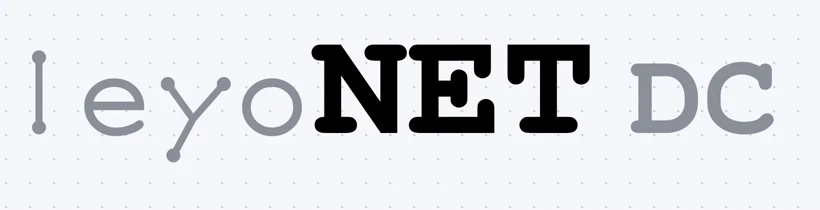
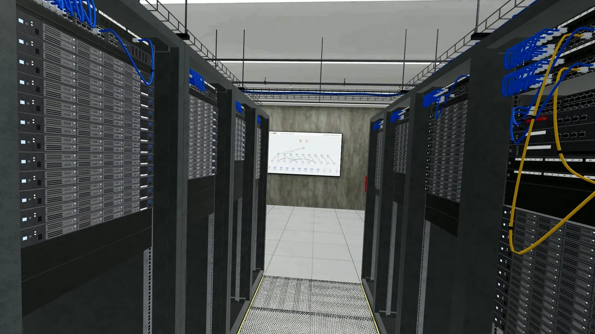
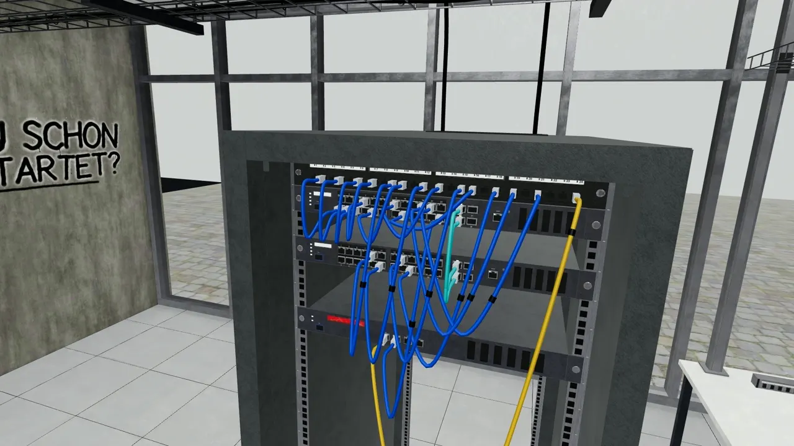
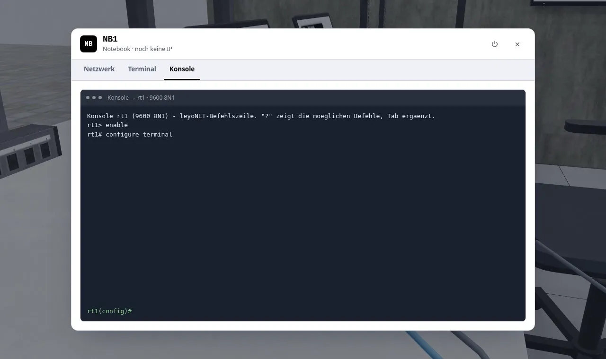
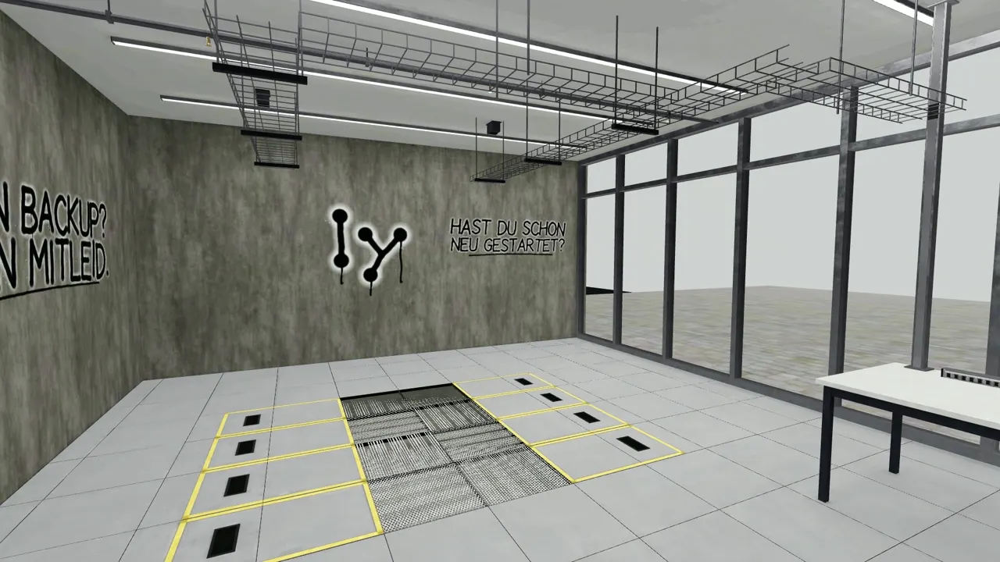
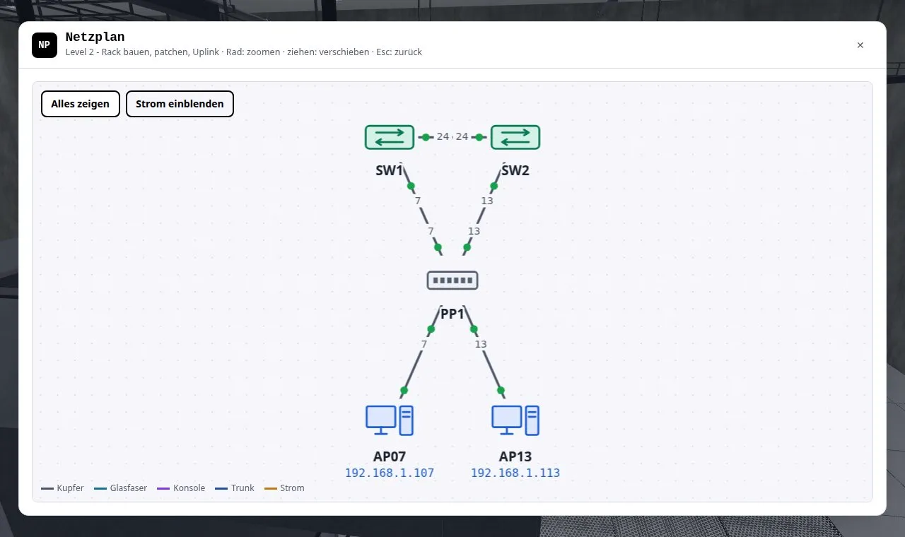

<p align="center"></p>

<p align="center"><strong>Der Datacenter-Simulator für den Informatik-Unterricht.</strong><br />Racks bauen, verkabeln, konfigurieren – in 3D, im Browser, mit dem echten leyoNET-Simulationskern.<br /><em>A free 3D data centre simulator for teaching computer networks (German).</em></p>

<p align="center">
  <a href="https://dc.leyonet.ch/"><strong>Im Browser spielen</strong></a> ·
  <a href="https://leyonet.ch">leyonet.ch</a> ·
  <a href="CHANGELOG.md">Änderungen</a> ·
  <a href="CONTRIBUTING.md">Mitmachen</a> ·
  <a href="https://patreon.com/leyonet">Unterstützen</a>
</p>

<p align="center">
  <a href="https://github.com/vonam-git/leyoNET-DC/actions/workflows/ci.yml"></a>
  <a href="LICENSE"></a>
</p>



## Was ist leyoNET DC?

DC steht für Datacenter, auf Deutsch Rechenzentrum. Im Spiel baust du eines selbst: Racks aufstellen, Switches, Router und Firewalls
einbauen, Strom und Netzwerk verkabeln und die Geräte an der Konsole einrichten. Ob dein Netz funktioniert, entscheidet der Simulationskern
von [leyoNET](https://github.com/vonam-git/leyoNET): Jeder Ping, jedes VLAN und jede BGP-Nachbarschaft wird wirklich gerechnet.

| | |
|---|---|
|  **Verkabeln** – Kupfer, Glasfaser mit SFP, Konsole, Strom, Trunks |  **Konfigurieren** – Befehlszeile mit `?`, Tab, SSH und KVM |
|  **Bauen** – leerer Raum, Budget, Shop und Inventar |  **Verstehen** – der Netzplan zeichnet mit |

- **7 Levels** vom ersten Kabel bis zu VLAN-Routing auf dem Core-Switch, selbst gebaut oder fertig aufgebaut
- **5 Verbundaufgaben** (★ bis ★★★★★): Die Klasse baut gemeinsam ein Netz aus Rechenzentren, mit Dashboard und Abnahme
- **Klassen** mit Pseudonymen, vom Server geprüfte Ergebnisse, Admin-Board für Lehrpersonen
- **Spielstände** auf dem Server (mit Klasse) oder als Datei, frei belegbare Tasten, Grafikstufen, Touch-Bedienung
- **Datenschutz:** keine Cookies, keine Werbung, nichts von fremden Servern, keine Namen

Die Levels und Verbundaufgaben sind kostenlos. Freies Bauen mit unbegrenztem Budget und das Demo-Rechenzentrum brauchen auf
dc.leyonet.ch einen Zugangscode.

## Selbst starten

Node.js 22 oder neuer, Git. Der Simulationskern ist ein Submodul:

```bash
git clone --recurse-submodules https://github.com/vonam-git/leyoNET-DC.git
cd leyoNET-DC/game
npm ci
npm run dev            # http://localhost:5173
npm run check          # alle Spiel-Tests
npm run build          # statische Seite in game/dist
```

Klassen und Admin-Board brauchen zusätzlich den Server (nur Node.js-Bordmittel):

```bash
cd game && npm run build:server
cd ../server && DC_ADMIN_INVITE=mindestens-16-zeichen npm start
node --test server/*.test.mjs      # im Hauptordner
```

Betrieb auf Plesk, Datenhaltung und Löschfristen: [docs/ADMIN_SERVER.md](docs/ADMIN_SERVER.md).

## Aufbau

| Ordner | Inhalt |
|---|---|
| `game/` | Spiel (three.js, Vite), Tests in `game/scripts/` |
| `server/` | Klassen, geprüfte Ergebnisse, Spielstände, Admin-Board |
| `blender/` | Skripte, die Raum und Geräte erzeugen (Blender headless) |
| `assets/out/` | fertige 3D-Modelle |
| `vendor/leyonet/` | leyoNET-Simulationskern (Submodul) |
| `docs/` | Konzept, [Protokoll](docs/SCENARIO_API.md), [Verbund](docs/VERBUND.md), [Server](docs/ADMIN_SERVER.md), [Herkunft](docs/HERKUNFT.md) |

## Entwickler und Lizenz

Copyright © 2026 **Mark v. A.** ([vonam.ch](https://vonam.ch)), entwickelt mit Hilfe von KI (Claude von Anthropic).

leyoNET DC ist freie Software unter der [GNU Affero General Public License](LICENSE), Version 3 oder neuer (`AGPL-3.0-or-later`), ohne jede
Gewährleistung. Wer eine veränderte Fassung über ein Netzwerk anbietet, muss deren Quelltext zugänglich machen. Der Name «leyoNET» und das
Logo sind davon ausgenommen. Fremdbestandteile (three.js, Texturen von ambientCG und weitere): [NOTICE.md](NOTICE.md),
[docs/HERKUNFT.md](docs/HERKUNFT.md).
